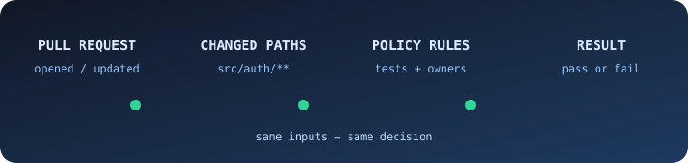
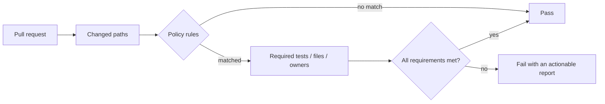

<div align="center">

# agent-policy-check

**Deterministic quality gates for every pull request.**

<p>
  <a href="https://github.com/Y-Seungmin/agent-policy-check/actions/workflows/test.yml"></a>
  <a href="https://github.com/Y-Seungmin/agent-policy-check/blob/main/LICENSE"></a>
  
  
</p>

<p>
  
</p>

</div>

`agent-policy-check` is a lightweight GitHub Action that turns repository quality rules into deterministic pull-request checks.

It is not an AI code reviewer. It applies repository-defined, path-based merge requirements to every pull request and produces the same result for the same inputs. There is no model call, source upload, external service, or code interpretation.

> Code review suggests what may be wrong. `agent-policy-check` proves whether your repository's explicit prerequisites were met.

## Why agent-policy-check?

| AI code review | agent-policy-check |
| --- | --- |
| Suggests possible problems | Enforces explicit prerequisites |
| Probabilistic and semantic | Deterministic and path-based |
| Reviews code from any context | Evaluates the policy at the PR base commit |
| Often needs a hosted service | Runs as a small, read-only Action |

The same policy and the same pull-request inputs always produce the same result.

## At a glance



## Quick start

Add `.github/workflows/agent-policy-check.yml`:

```yaml
name: agent-policy-check

on:
  pull_request:
    types: [opened, synchronize, reopened, ready_for_review]

permissions:
  contents: read
  pull-requests: read

jobs:
  agent-policy-check:
    runs-on: ubuntu-24.04
    timeout-minutes: 5
    steps:
      - uses: Y-Seungmin/agent-policy-check@v0
        with:
          github-token: ${{ secrets.GITHUB_TOKEN }}
```

No checkout step is required. The Action reads the policy and CODEOWNERS file directly from the pull request's trusted base commit.

Then add `.policy-check.yml` at the repository root:

```yaml
version: 1
rules:
  - name: auth changes require tests and ownership
    when:
      paths:
        - src/auth/**
    require:
      - changed-path: tests/auth/**
      - codeowners-covered: true

  - name: migrations require rollback coverage
    when:
      paths:
        - db/migrations/**
    require:
      - changed-path: db/rollback/**
      - changed-path: tests/migrations/**

  - name: workflow changes require ownership
    when:
      paths:
        - .github/workflows/**
    require:
      - codeowners-covered: true
```

## Policy reference

A v1 policy contains named rules. A rule runs when at least one changed path matches one of its `when.paths` patterns.

| Requirement | Meaning |
| --- | --- |
| `changed-path: <glob>` | At least one live destination path in the pull request must match the glob. |
| `codeowners-covered: true` | Every path that triggered the rule must have at least one owner in the base commit's CODEOWNERS file. |

Unknown fields, unsupported requirements, duplicate rule names, empty lists, and malformed YAML fail the check. Policy paths are case-sensitive.

### Renames and deletions

Rename and deletion behavior is deliberately fail-closed:

| Change | Can trigger `when.paths` | Can satisfy `changed-path` |
| --- | --- | --- |
| Added or modified file | Current path | Current path |
| Deleted file | Deleted path | No |
| Renamed file | Previous and current paths | Current destination only |

This prevents moving a sensitive file out of a protected directory or deleting a required test file from bypassing a rule.

### Glob support

Policy paths support `*`, `?`, and `**`. A policy glob is matched from the repository root.

```yaml
when:
  paths:
    - src/*.ts
    - packages/**/security/*.ts
```

Character classes such as `[a-z]`, backslashes, and negated patterns beginning with `!` are rejected to keep matching explicit and portable.

## CODEOWNERS and code owner approval

The first CODEOWNERS file found at the pull request base commit is used, following GitHub's search order:

1. `.github/CODEOWNERS`
2. `CODEOWNERS`
3. `docs/CODEOWNERS`

Supported behavior includes `*`, `?`, `**`, root-anchored patterns, directory patterns, inline comments, email owners, last-match precedence, and ownerless exception rules.

`codeowners-covered: true` checks **coverage, not review approval**. To require code owner approval before merge, enable **Require review from Code Owners** in the base branch's ruleset or branch protection settings. Keeping approval enforcement in GitHub avoids organization-membership permissions and stale review-state logic inside this Action.

## Trust model

The Action treats pull-request code as untrusted:

- Changed files come from the GitHub Pull Requests API.
- `.policy-check.yml` and CODEOWNERS come from the exact `base.sha` in the event payload.
- A pull request cannot weaken the policy that evaluates itself.
- Only a genuine GitHub `404` means an optional file is absent. Permission, network, malformed-response, and invalid-policy errors fail the check.
- The pull request head SHA is verified after loading the file list. If the pull request advances during evaluation, the run fails and asks for a rerun on the latest commit.
- Pull requests with more than 3,000 changed files fail closed because GitHub's files API cannot return a complete list beyond that limit.

If `.policy-check.yml` does not exist on the base commit, the Action reports `skipped`. This allows agent-policy-check to be introduced without breaking the pull request that adds the first policy.

## Results and outputs

Every evaluated run writes a GitHub job summary. Failed checks include the rule name, matched paths, and missing requirements. Reports are escaped and capped so a large pull request cannot flood the job summary.

| Output | Values |
| --- | --- |
| `result` | `passed`, `failed`, or `skipped` |
| `violation-count` | Number of violated policy rules |

```yaml
- id: policy
  uses: Y-Seungmin/agent-policy-check@v0
  with:
    github-token: ${{ secrets.GITHUB_TOKEN }}

- if: always()
  run: echo "Result: ${{ steps.policy.outputs.result }}"
```

## Permissions and privacy

The Action needs read-only permissions:

```yaml
permissions:
  contents: read
  pull-requests: read
```

Repository files and metadata are read through the GitHub API. Nothing is sent to an LLM or a separate service, and the Action does not modify code, reviews, labels, or pull requests.

## Development

Node.js 24 and pnpm 11 are required.

```bash
corepack enable
pnpm install --frozen-lockfile
pnpm run verify
```

The verification gate includes unit tests with coverage thresholds, a TypeScript build, Node 24 end-to-end execution of the bundled Action against a local GitHub-compatible HTTP server, and a production dependency audit.

CI additionally validates workflow syntax and expressions with a pinned actionlint release.

GitHub Actions execute `dist/index.js`, so every release must include a freshly built bundle that matches `src/`.

## Scope

`agent-policy-check` intentionally does not perform AI review, semantic code analysis, automatic fixes, commits, review approval checks, or organization membership lookups. Its v0 contract is small, deterministic, and inspectable.

## License

[MIT](LICENSE)
